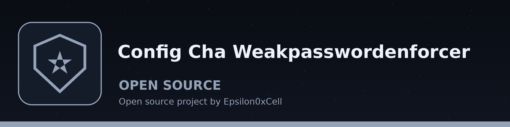

# config-cha-WeakPasswordEnforcer
Checks user accounts for weak or default passwords against a built-in dictionary and common patterns. Employs the `pwnedpasswords` library for checking against compromised password lists and `python-dateutil` for detecting date-based passwords. Reports accounts with potentially vulnerable credentials.

## Install
`git clone https://github.com/ShadowGuard-AI/config-cha-weakpasswordenforcer`

## Usage
`python3 main.py [-u USERFILE -p PASSWORDFILE | -c CONFIGFILE] [-w WEAKPASSWORDS] [-t THRESHOLD] [--disable-pwned] [--disable-date] [--disable-common]`

## Parameters
- `-h`: Show help message and exit
- `-u`, `--userfile`: Path to a file containing a list of usernames (one per line). Use together with `-p`; the two files are paired by line position.
- `-p`, `--passwordfile`: Path to a file containing a list of passwords (one per line).
- `-c`, `--configfile`: Path to a YAML configuration file with user and password information. Use this instead of `-u` and `-p`.
- `-w`, `--weakpasswords`: Path to a file containing a list of weak passwords. Defaults to a built-in list.
- `-t`, `--threshold`: Threshold for the pwnedpasswords check. A password is flagged when its pwned count reaches this threshold (the code uses greater than or equal to, not strictly greater than). Default: 10.
- `--disable-pwned`: Disable checking against the pwnedpasswords database.
- `--disable-date`: Disable date-based password detection.
- `--disable-common`: Disable checking against common password list.

## Verified behavior
- With `--disable-pwned --disable-date`, a user whose password is `password` is flagged as a common weak password and the run exits 1.
- Without `--disable-pwned`, when the `pwnedpasswords` library is not installed, the run exits 1 with the message to install it or pass `--disable-pwned`. No live Have I Been Pwned lookup was attempted in this wave.
- The built-in weak list contains only six entries: password, 123456, qwerty, admin, default, and 123456789. The common check alone does not flag passwords outside that list, for example `password123`.

## License
See LICENSE.
