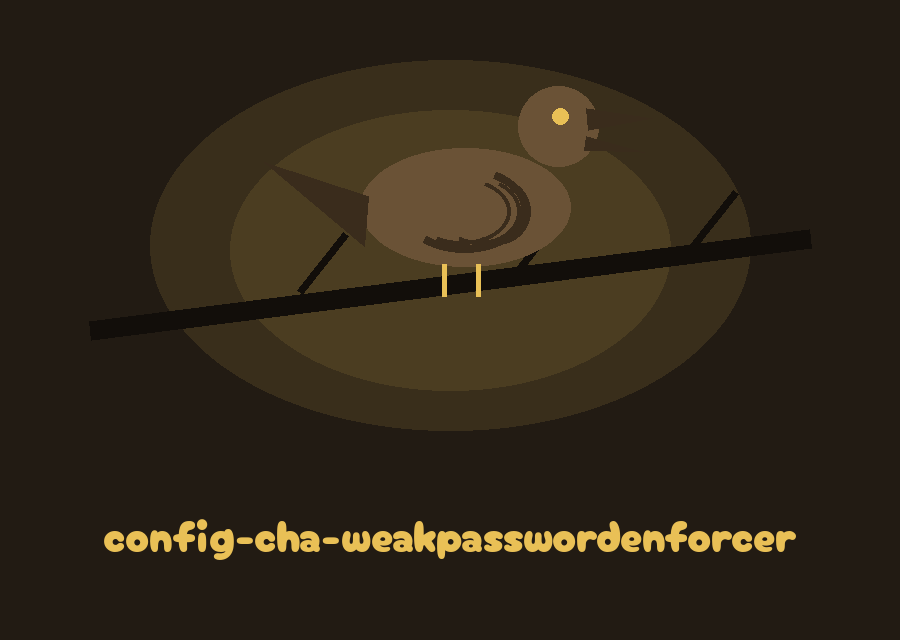

# config-cha-WeakPasswordEnforcer

Title block: the name above is set in Cherry Bomb One in eye gold on a bark plate ruled as a page of the night watch log, the hour entered first in small Cabin. A small nightingale glyph stands beside this heading and beside no other: 🐦. The remaining headings keep the log treatment, the hour noted and a small lantern at the left, without the bird, so that a long document stays quick to scan.

Checks user accounts for weak or default passwords against a built-in dictionary and common patterns. Employs the `pwnedpasswords` library for checking against compromised password lists and `python-dateutil` for detecting date-based passwords. Reports accounts with potentially vulnerable credentials.

## Install

`git clone https://github.com/ShadowGuard-AI/config-cha-weakpasswordenforcer`

> **Wireless room notice: the gap is recorded, not repaired.** The install above is the single clone line and nothing more. The README names no change of directory and no dependency step, although the program imports the pwnedpasswords library, the python-dateutil parser, and YAML, and although the repository carries a requirements file. No step is invented here that the README does not contain.

## Usage

`python3 main.py [-u USERFILE -p PASSWORDFILE | -c CONFIGFILE] [-w WEAKPASSWORDS] [-t THRESHOLD] [--disable-pwned] [--disable-date] [--disable-common]`

> **Wireless room notice: a standing order, read whole.** The two single files are an alternative to the configuration file and not an addition to it. The user file and the credential file must hold the same number of lines, because they are paired by line position alone. A caller who supplies neither the pair nor the configuration file is refused with an error and exit 1 before any checking begins. Buttons in the kit read Run the Three Checks, Load a YAML Configuration, Load Paired Files, and Show Help.

## Parameters

- `-h`: Show help message and exit
- `-u`, `--userfile`: Path to a file containing a list of usernames (one per line). Use together with `-p`; the two files are paired by line position.
- `-p`, `--passwordfile`: Path to a file containing a list of passwords (one per line).
- `-c`, `--configfile`: Path to a YAML configuration file with user and password information. Use this instead of `-u` and `-p`.
- `-w`, `--weakpasswords`: Path to a file containing a list of weak passwords. Defaults to a built-in list.
- `-t`, `--threshold`: Threshold for the pwnedpasswords check. A password is flagged when its pwned count reaches this threshold (the code uses greater than or equal to, not strictly greater than). Default: 10.
- `--disable-pwned`: Disable checking against the pwnedpasswords database.
- `--disable-date`: Disable date-based password detection.
- `--disable-common`: Disable checking against common password list.

> **Wireless room notice: The Compromised Check Cannot Run Without Its Library.** When the pwnedpasswords library is not installed and the compromised check has not been disabled, the run refuses at the outset with exit 1 and a message telling the caller either to install it or to disable the check. Headings on this page read Three Checks, No More, Paired by Line Position, Six Entries in the Built In List, A Count That Reaches Ten Is Flagged, and A Failed Lookup Flags Nobody.

## Verified behavior

- With `--disable-pwned --disable-date`, a user whose credential is one listed weak entry is flagged as a common weak password and the run exits 1.
- Without `--disable-pwned`, when the `pwnedpasswords` library is not installed, the run exits 1 with the message to install it or pass `--disable-pwned`. No live Have I Been Pwned lookup was attempted in this wave.
- The built-in weak list contains only six entries, counted here and not quoted. The common check alone does not flag credentials outside that list, for example a listed entry with further characters appended.

> **Wireless room notice: values withheld, behaviours kept.** No credential value and no example secret is printed in this README. The verified lines above are preserved with the quoted values withheld under that rule, and their behaviours stated as facts: a listed weak entry is flagged by the common check, a missing weak list file falls back to the built in six, and a failed lookup against the service warns about that account and does not flag it, so an offline run may pass accounts it never truly checked.

## License

See LICENSE.

> **Wireless room notice: the log is ruled off.** The licence entry closes as the README closes it, with the words See LICENSE, and no holder and no terms are invented beyond them. A run in which any account is flagged by any surviving check ends with exit 1, while a run that flags nobody ends quietly at 0.

> **The last entry, ruled off.** The round, stated whole: config-cha-weakpasswordenforcer reads pairs of usernames and credentials, either from two files paired line by line or from one YAML configuration file whose entries are username and credential pairs, and it puts every credential through up to three checks, a common check against a list of weak entries, a compromised check against the pwnedpasswords service through its library, which flags a credential whose count in that service has reached the threshold the caller sets, and a date check, which asks whether the whole credential, taken entire and with nothing added, parses as a date, and a run in which any account is flagged by any surviving check ends with exit 1, while a run that flags nobody ends quietly at 0. The pairing condition stands: the user file and the credential file must hold the same number of lines because they are paired by line position alone. The YAML alternative demands that keys and values be strings. The weak list is the built in list, which holds six entries only; a file named there but not found does not end the run, for the program notes the failure and falls back to that built in list, under the heading A Missing Weak List Falls Back to the Built In Six. The threshold is defaulting to 10, and flagging occurs when the count reaches the threshold and not only when it passes beyond it. Last, when a single lookup against the service fails, that account is warned about and not flagged, which means an offline run may pass accounts it never truly checked, and a listed weak entry with further characters appended escapes it entirely.
